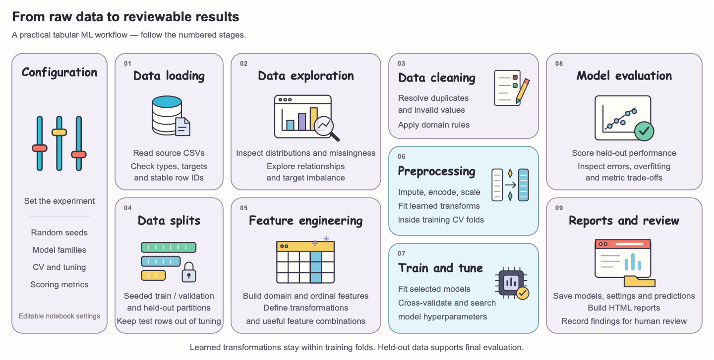

# Traditional Data Science, Analytics & Machine Learning

**A practical portfolio demonstrating the ability to turn tabular data into defensible statistical findings, reproducible machine-learning experiments, and clear reports.**

[](https://www.python.org/) [](https://jupyter.org/) [](https://developer.mozilla.org/en-US/docs/Web/HTML) [](https://developer.mozilla.org/en-US/docs/Web/CSS)

**Libraries**

[](https://numpy.org/) [](https://pandas.pydata.org/) [](https://matplotlib.org/) [](https://seaborn.pydata.org/) [](https://plotly.com/python/) [](https://www.statsmodels.org/) [](https://scikit-learn.org/) [](https://scipy.org/) [](https://xgboost.readthedocs.io/) [](https://joblib.readthedocs.io/) [](https://pydotplus.readthedocs.io/) [](https://graphviz.org/) [](https://coin-or.github.io/pulp/)

The projects cover property and vehicle pricing, customer purchase classification, customer segmentation, housing statistics, service-request analytics, and introductory optimization. Each notebook connects a business question to data exploration, explicit cleaning decisions, appropriate methods, and interpretable results.

Workflows are run manually in Jupyter or VS Code. Editable settings, fitted preprocessing, held-out evaluation, saved artifacts, and written observations make the analytical process reviewable and reproducible.

[ML Workflow](#ml-workflow) · [Use Cases](#use-cases) · [Quick Start](#quick-start) · [Run Guide](#run-guide) · [Topics Covered](#topics-covered) · [Artifacts & Reports](#artifacts--reports)

---

## ML Workflow

A typical tabular ML workflow moves from raw data to evaluated models and reviewable evidence. The notebooks make each stage explicit:

[](resources/ml_workflow.svg)

This repository shows how I prepare data, train models, and evaluate results in a reproducible way. Features use domain knowledge, and transformations that learn from data are fitted within training folds to prevent information leakage.

| Focus area | How the project handles it |
| :--- | :--- |
| **Reliable data** | Checks data structure and labels, applies domain rules, handles duplicates, and keeps IDs to investigate errors. |
| **Repeatable results** | Records random seeds, settings, data fingerprints, and run details so experiments can be reproduced. |
| **Fair model evaluation** | Fits data transformations within training folds, tunes models using training data, and evaluates them on held-out data. |
| **Reviewable results** | Saves fitted models, scores, data splits, predictions, experiment settings, and interactive HTML reports. |
| **Clear decision-making** | Compares regression models for human review, reports classifier results separately, and explains assumptions and uncertainty in statistical findings. |
| **Consistent reruns** | Refreshes saved outputs when experiments are rerun and clears outdated regression test results after retraining. |

The project currently runs locally and covers data analysis, model training, and offline evaluation. Model serving, automated deployment, and live monitoring are future extensions.

## Use Cases

| Project | Question | What it demonstrates | Start here |
|---|---|---|---|
| 🏠 **House-price regression** | How accurately can property characteristics explain a sale price? | Domain cleaning, area/age/quality features, regularized and tree models, CV/tuning, frozen-candidate testing, and model comparisons | [House-price guide](regression/house_price_prediction/readme.md) |
| 🚗 **Car-price regression** | How do vehicle age, mileage, specifications, and market categories relate to price? | Missing-measurement handling, snapshot-age features, nonlinear models, percentage-error and price-band diagnostics | [Car-price guide](regression/car_price_prediction/readme.md) |
| 🛍️ **Customer purchase classification** | Will a customer make a purchase? | Shared preparation, seven independently documented classifiers, recall/precision trade-offs, continuous-score ROC/PR analysis, and a report per model | [Classification guide](classification/readme.md) |
| 👥 **Customer segmentation** | Which customer groups have distinct income, age, and spending patterns? | Quality checks, standardized distances, K-Means, Ward clustering, cluster-count diagnostics, and original-unit segment profiles | [Segmentation notebook](clustering/customer_segmentation.ipynb) |
| 🏘️ **Housing statistics** | What do recorded housing aggregates show, and how does sampling uncertainty behave? | EDA, CLT/LLN demonstrations, confidence intervals, z/t/F tests, robust dispersion checks, count-based chi-square, and probability | [Housing statistics notebook](statistics/housing_data_analysis/python_statistics.ipynb) |
| 📞 **Service-request analytics** | Which requests dominate the workload, and how do closure durations differ? | Mixed-format date parsing, multi-day durations, conditional closure probabilities, temporal dependence, Welch/Holm comparisons, and borough association | [Service-request notebook](statistics/service_requests_analysis/customer_service_requests.ipynb) |
| 📦 **Linear optimization** | How can supply, demand, and capacity constraints guide allocation? | A PuLP transportation example, a storage-allocation feasibility check, and an exact bin-packing solve compared against a quick heuristic | [Optimization notebook](linear_optimization/pulp_optimization.ipynb) |

## Quick Start

The included `Makefile` sets up a virtual environment, installs dependencies, and downloads every dataset in one step:

```bash
make setup
```

This runs, in order:

| Target | What it does |
|---|---|
| `make venv` | Creates a `.venv` virtual environment (uses `python3.14`; edit the `PYTHON` variable in the Makefile if you use a different interpreter) |
| `make install` | Installs everything in `requirements.txt` into `.venv` |
| `make data` | Downloads all datasets from Google Drive into their project folders and verifies every expected CSV is present |

Run `make install` or `make data` individually if you only need one step, or `make clean` to remove `.venv`.

Once setup finishes, activate the environment and start Jupyter:

```bash
source .venv/bin/activate
python -m jupyter notebook
```

Open a notebook and choose **Run All**. You can also use VS Code with the same `.venv` Python environment.

## Run Guide

For house-price and car-price regression, run notebooks **01 → 02 → 03 → 04 → 05**. For classification, run **01 → 02**, then any **03** classifier notebook you want. Run each clustering or statistics notebook from top to bottom.

Training and testing notebooks generate artifacts and reports automatically. Open the HTML reports in your browser.

## Topics Covered

A tour of everything packed under the hood, from first-pass spreadsheet cleanup to gradient-boosted models:

### 🔍 Analytics and data preparation

Schema inspection; numeric/categorical summaries; missingness; duplicate/identifier audits; invalid-value handling; skewness; histograms, boxplots, scatterplots, correlations and empirical CDFs; group/price-band profiles; mixed-format datetime parsing; calendar exposure; and clear analytical denominators.

### 🎲 Probability and statistical inference

Empirical, marginal, joint and conditional probability; Bayes' identity; total probability; binomial experiments; Wilson intervals; CLT and LLN; repeated-sampling coverage; 90/95/99% confidence intervals; one-/two-sample z and t illustrations; Welch mean comparisons; F-test assumptions; Brown–Forsythe dispersion checks; count-based chi-square; Cramér's V; standardized mean differences; Holm adjustment; and seven-day moving-block bootstrap sensitivity analysis.

The notebooks distinguish a statistic's sampling distribution from the raw-data distribution, simulation from observational inference, statistical detectability from practical effect size, and association from causation — the small distinctions that keep a finding honest.

### 🤖 Supervised machine learning

| Area | Model families and evaluation |
|---|---|
| **Regression** | Median baseline; Linear Regression, Ridge, Lasso and ElasticNet; Random Forest; gradient and histogram boosting; optional XGBoost; Decision Tree in car pricing |
| **Regression metrics** | RMSE, MAE, RMSLE and R²; train/validation gaps, CV spread, overfitting flags, and held-out candidate comparisons; car-price percentage and price-band errors |
| **Classification** | Logistic Regression, KNN, Gaussian Naive Bayes, Decision Tree, Random Forest, SVC and XGBoost |
| **Classification metrics** | Accuracy, balanced accuracy, precision, recall, F1, confusion matrices, continuous-score ROC AUC, average precision/PR curves, and probability log loss where applicable |
| **Model preparation** | Domain/ordinal features, log-target transforms, imputation, one-hot encoding, numeric scaling, optional polynomial expansion, model-specific assumptions, and training-only hyperparameter search |

Recall is the default classification CV objective because the customer-purchase use case emphasizes missed purchasers — better to flag a few extra than let a buyer slip through. Precision and F1 remain visible to assess the trade-off. SVC uses decision margins for ROC/PR rather than presenting those scores as probabilities.

### 🧩 Unsupervised learning and optimization

**Customer segmentation:** K-Means and Ward hierarchical clustering group customers with similar age, income, and spending patterns. Features are scaled so their different units do not dominate the results. The elbow curve, silhouette score, and Davies–Bouldin index help assess the number of groups and how distinct they are. Group sizes and customer profiles then explain what each segment represents.

**Resource allocation:** The PuLP transportation example explores how to minimize delivery costs while meeting supply and demand requirements. It demonstrates how to express a business goal as an optimization problem, define allocation decisions, and enforce practical constraints. Draft storage examples also explore capacity limits and unused space.

## Artifacts & Reports

Supervised models write reproducible outputs next to their project notebooks:

| Area | Artifacts | Reports |
|---|---|---|
| [House prices](regression/house_price_prediction/artifacts/) | Frozen candidates, metadata, CV/validation scores, and combined evaluation tables | [Training](regression/house_price_prediction/reports/training_performance.html), [testing](regression/house_price_prediction/reports/testing_evaluation.html), [comparison](regression/house_price_prediction/reports/model_comparison.html) |
| [Car prices](regression/car_price_prediction/artifacts/) | The same core artifacts, plus per-car errors and price-band tables | [Training](regression/car_price_prediction/reports/training_performance.html), [testing](regression/car_price_prediction/reports/testing_evaluation.html), [comparison](regression/car_price_prediction/reports/model_comparison.html) |
| [Classification](classification/artifacts/) | Shared cleaning audit; each classifier's model, parameters, split files, predictions, CV results, and metrics | [Seven separate model reports](classification/reports/) |